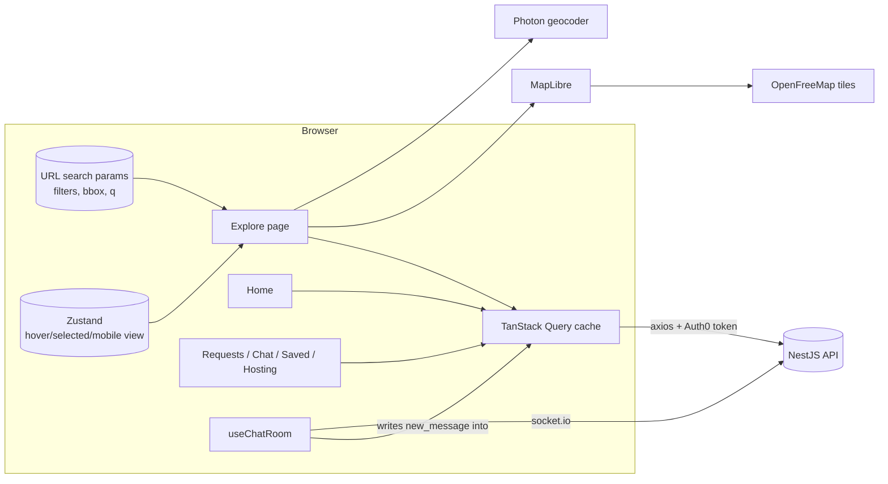

# Workahomies web (v3)

New web client for Workahomies: React 19 + TypeScript, Vite, Tailwind CSS v4, TanStack Query, Zustand, MapLibre GL.
Replaces `apps/web` (Chakra) and the abandoned `web-v2` attempt. The Home page is built to sell the Android app.

## Run

```bash
cp apps/web-v3/.env.template apps/web-v3/.env   # fill in Auth0 values
npm install                                     # from the repo root (workspaces)
npm run dev --workspace=web-v3                  # http://localhost:3001
```

Without `VITE_AUTH0_*` the app runs anonymously (browse, map, host pages); signed-in pages show a notice.

| Script | What it does |
| --- | --- |
| `npm run dev --workspace=web-v3` | Vite dev server on :3001 |
| `npm run build --workspace=web-v3` | Type-check + production build to `dist/` |
| `npm run typecheck --workspace=web-v3` | `tsc -b --noEmit` |
| `npm test --workspace=web-v3` | Vitest unit tests |

## Maps without a bill

| Need | Provider | Cost / key |
| --- | --- | --- |
| Vector tiles + style | [OpenFreeMap](https://openfreemap.org) (`positron`), re-tinted at runtime to the brand palette | Free, no key, no request limits |
| Rendering | MapLibre GL JS via `react-map-gl/maplibre` (WebGL, smooth zoom, retina) | OSS |
| Clustering | `supercluster` over `/hosts/pins` | OSS |
| Search-as-you-type | [Photon](https://photon.komoot.io) (OSM) | Free, fair use |
| Reverse geocoding (host drops a pin) | Nominatim | Free, low volume only |

Swap the style with `VITE_MAP_STYLE_URL` (any MapLibre style, e.g. MapTiler/Stadia later) without code changes.
The old app used `tile.openstreetmap.org` raster tiles, which the OSM tile policy disallows for production apps.

Privacy: public pages show an **approximate area** (deterministic 150–300 m offset + 500 m circle), never the exact pin.

## Architecture



**State rules**
- Server state → TanStack Query only (hosts, pins, requests, chat messages, wishlist).
- Shareable state → URL (`/explore?lat=…&lng=…&q=Dublin&occ=writer&fac=wifi&rate=4&bbox=…`).
- Ephemeral UI state shared across distant components → one small Zustand store (`stores/explore.ts`).

## Layout

```
src/
  auth/          Auth0 provider, useSession, RequireAuth
  components/    ui primitives, layout, map (BaseMap, markers, clustering, pickers)
  features/      data hooks per domain (hosts, requests, reviews, wishlist, chat, stats)
  lib/           api client, env, geo helpers, geocoding, socket, types
  pages/         home, explore, host, dashboard, how-it-works
  stores/        Zustand
```

## Monorepo note

`apps/web` keeps React 18 hoisted at the root `node_modules`. `vite.config.ts` uses `resolve.dedupe` so every
dependency shares this app's React 19. Remove it once `apps/web` is retired.
